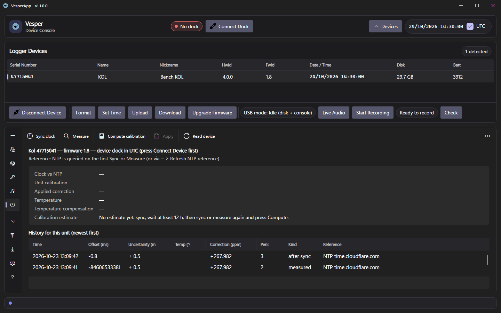

# Clock Calibration

KOL, Vesper, Pipistrelle and Nanotag loggers keep time with a 32.768 kHz crystal. Every crystal is a little fast or slow (typically ±20–30 ppm, about ±2–3 seconds a day, but on some boards much more: KOL units measured about −200 ppm, 17 seconds a day slow), and outdoors it also runs slow when it is colder or warmer than about 25 °C. The **Clock** page sets a unit's clock to internet time with millisecond accuracy, measures how fast or slow that particular unit's crystal is, and stores a correction on the unit.

This needs firmware with the time-sync commands (KOL 1.8 / Vesper 1.22 / Nanotag 1.37 or later). Older firmware still gets a plain whole-second **Set Time**.

## UTC or local time

Loggers keep **UTC** by default — GNSS positions need it. Untick the **UTC** switch in the top bar to set loggers to this PC's local time instead; the choice is saved. Every clock set (Set Time, Sync clock) tells the logger which one it gets, together with the local time's offset. The logger keeps that with its clock and marks its data with it, so the data decodes to the right time on any PC, also on one that did not set the clock (Nanotag 1.39 or later; KOL and Vesper / Pipistrelle follow).

- A logger set to local time keeps the offset it was set with (for example UTC+02:00) for the whole deployment; it does not follow daylight-saving changes.
- The device list shows the logger's time and, on a Nanotag 1.39+, `UTC` or `local time (UTC+02:00)`. "UTC or local not known" means the clock was set by an older VesperApp or from the console: press **Set Time** before deploying (**Arm** offers it).
- A Nanotag download names its GNSS snapshot files in UTC and writes `CLOCK.txt` saying which time the files are in.

*The Clock tab: sync, measure and apply on the toolbar; the unit's clock against internet time, its calibration and temperature, and the history of measurements for this unit.*

## Where the time comes from

The app asks internet time servers (NTP) for the true time; the PC's own clock is often off by a second or more. If no server answers (the network blocks UDP port 123), the page says so and falls back to the PC clock — fine for setting the time roughly, not for calibration. To use your own time servers set the environment variable `VESPERAPP_NTP_SERVERS` (comma separated).

## Sync clock

**Sync clock** (also what **Set Time** in the device panel does for these loggers, the Nanotag included) measures the unit's clock about 30 times over USB, removes the USB delay, sets the whole seconds if needed and then nudges the clock by the remaining fraction of a second. The result — typically within about one millisecond — is shown and recorded in the unit's history. UTC or local time: see above.

## Calibrating a unit

1. Connect the unit and press **Sync clock**.
2. Leave it at a **stable room temperature for 12–24 hours** (it can be unplugged; the longer, the more precise).
3. Connect it again and press **Sync clock** (or **Measure**, which does not change the clock).
4. Press **Compute calibration**. The page shows the crystal error in ppm and in seconds per day, its uncertainty, the measurement span and the temperature, plus a note if something was not ideal (short span, changing temperature, PC clock used as reference).
5. Connect the unit in **Idle** mode (so its disk appears on the PC) and press **Apply**. The correction takes effect on the unit at once, is kept on this PC as the master copy, and is saved on the unit's own disk so it survives switching the unit off:
   - `RTCCAL.TXT` next to `UID.TXT` — read by the unit at every start (KOL 1.8 / Vesper 1.22 or later). It names the unit's serial, so it is ignored if the disk's files are copied onto another unit.
   - the *Clock Drift* (`cdrift`) value in the unit's `config.json` — the same correction for units with older firmware.

   If the disk is not found, the page says so; the correction then only lasts until the unit loses power — connect it in Idle mode and press **Apply** again.

Copying a new deployment `config.json` onto a unit replaces its *Clock Drift* value but not `RTCCAL.TXT`, so units with current firmware keep their calibration. **Clear unit calibration** (in the ··· menu) removes it from the unit and deletes `RTCCAL.TXT`; the unit then uses the configuration file's *Clock Drift* value, which still holds the calibrated value until a new configuration is copied on.

Each unit is identified by its serial number. The **History** table lists every measurement for the selected unit; a new *Period* starts whenever the clock or the calibration is changed, and calibration is only ever computed within one period.

## Temperature compensation

Enable **RTC temperature compensation** in the [Configuration Editor](Configuration-Editor) to correct for temperature as well. The unit then reads its internal temperature sensor periodically (every 10 minutes by default) and follows the crystal's temperature curve, which also lets it hold the correction more finely than the clock hardware's 0.95 ppm steps. The optional fields are the curve's steepness (ppb/°C², default 34 for a standard watch crystal), the temperature where the crystal is fastest (default 25.0 °C) and the measurement interval. Leave them empty unless you have the crystal's datasheet values.

| Setting | Accuracy to expect after a good 24 h calibration |
|---|---|
| Calibration only | within about ±0.5 ppm at room temperature (±40 ms/day); slower when cold or hot (5 °C: about −14 ppm) |
| Calibration + temperature compensation | about ±2–5 ppm across field temperatures, limited by the sensor and the crystal's real curve |

The **Clock** page shows the unit's current temperature, the correction it applies and whether temperature compensation is on.

## Nanotag

A Nanotag with firmware 1.37 or later works on the same page over its USB connection (select it and press **Connect Device**): measuring, calibrating, applying, clearing and temperature readings are the same. Two differences:

- **Sync sets whole seconds only.** The Nanotag's clock cannot be moved by a fraction of a second, so after **Sync clock** it can still be up to half a second off. The page measures that offset to the millisecond and keeps it in the unit's history; subtract it from the tag's timestamps when you need millisecond accuracy.
- **The calibration is stored in the tag itself** (its EEPROM), so it survives a flat battery; there is no file on a disk. The correction is applied in steps of about 1 ppm (shown as FREQCORR steps) and dithered, so on average it follows the calibration exactly.

Temperature compensation is set in the Configuration Editor and reaches the tag with the configuration upload.

