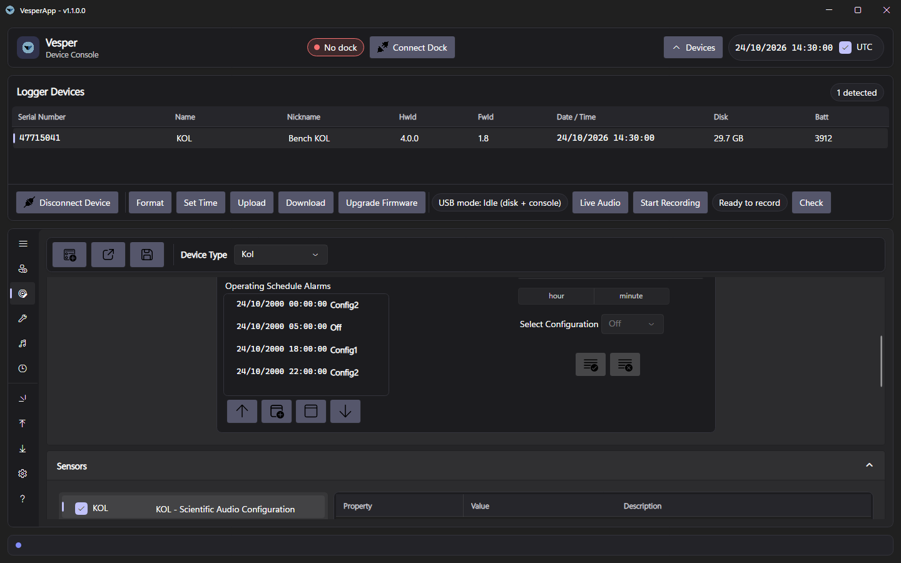
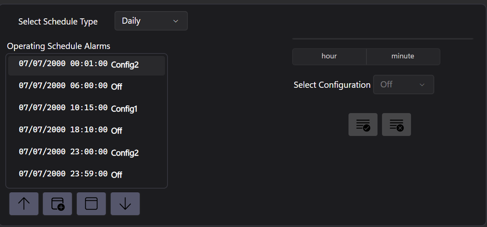

# Configuration Editor

The **Configuration** tab edits the JSON configuration that tells a device *what to record and when*. You can load a configuration from a file, adjust it, and save it back. Configuration files can also be opened straight from the [Recordings](Recordings) data browser — double-click a `.json` that the app recognises as a device configuration (e.g. the config imported alongside a device's recordings) and confirm.



*The Configuration tab: device type selection, schedule editor and per-sensor driver settings.*

## General device settings

| Setting | Meaning |
|---|---|
| **Device name** | Device name - used by the device to validate the configuration matches target device; this is autopopulted by Device pick |
| **Minimum hardware** | The hardware revision this configuration requires (e.g. `4.0`) |
| **Allow magnet turn-off** | Whether a magnet may power the device down in the field (after activation) |
| **Battery capacity** | The fitted battery's capacity in mAh (informational, used for documentation - no real impact on execution) |
| **Power-on time/delay** | Optional power-on time/delay after magnet activation - when the device becomes active — an absolute date/time or relative delay |
| **Clock drift** | Legacy RTC drift constant, the same for every unit (a raw value for the clock's calibration register). Units calibrated on the [Clock Calibration](Clock-Calibration) page use their own measured value instead; leave empty for no correction |
| **RTC temperature compensation** | KOL / Vesper / Pipistrelle: periodically read the internal temperature sensor and correct the clock crystal's temperature drift. Off unless ticked; the optional curve steepness, turnover temperature and interval default to 34 ppb/°C², 25.0 °C and 600 s — see [Clock Calibration](Clock-Calibration) |

Selecting a device type pre-fills the device name and clock drift (Vesper, Pipistrelle and KOL use `32999`; Nanotag has none) — both can be adjusted before saving.

## Recording schedules

There are 4 types of schedules supported:

| Type | Behaviour |
|---|---|
| **Continuous** | Record continuously after activation while powered. Can be stopped manually via magnet if enabled on the General section. |
| **Daily** | Repeat the same time windows every 24HR; schdule runs 00:00 to 23:59 if entry should run over midnight, split it till 23:59 and after 00:00 |
| **Dated** | Run in specific calendar windows based on absolute dates |
| **Relative** | Windows relative to date of magnet activation with dates relative to date of activation (1,2,3...) |

A configuration contains one or more **schedule blocks** marked as **config0 (Off)**, **config1 (On)**, **config2 (On)**.
Blocks define when each sensor records, so you can, for example, record audio only at night while sampling environment sensors around the clock.  
**Continues** schedule type always uses **config1** block, while **Daily**, **Dated** and **Relative** schedule types use **config1** and **config2** blocks as needed.

Schedule is edited in the **Schedule** tab, which shows a visual representation of the schedule blocks. The schedule consists of array of JSON objects where each object represents a change in state entry, and you can also edit the JSON directly.
  
This example shows a daily schedule with two blocks: **config1** (On) from 10:15 to 18:10, and **config2** (On) from 23:00 to 06:00. The rest of the time the device is in **config0** (Off) state. Note - to defined overnight rollover, the schedule split from 23:00 to 23:59 and from 00:01 to 06:00.  
Same can be achieved with manually editing the JSON schedule array, for example:
```json
[
    {"time":"2000-07-07 00:01:00","config":2},
    {"time":"2000-07-07 06:00:00","config":0},
    {"time":"2000-07-07 10:15:00","config":1},
    {"time":"2000-07-07 18:10:00","config":0},
    {"time":"2000-07-07 23:00:00","config":2},
    {"time":"2000-07-07 23:59:00","config":0}
]
```

## Sensor drivers

Each sensor on the device is configured through its **driver** entry — sampling rate, gain, channel selection and other per-sensor options. The property editor renders every driver's options directly from the device's own metadata, so new sensor types appear automatically with the correct choices. Typical drivers include the audio front-end, IMU, EXG (48-channel or 2-channel 1292 variants), environmental sensors, ambient light and proximity.

Every driver pane has the same layout: **Standard configuration** first (sample rate, window length and rate per config, LED), then the sensor's own groups, then **Advanced configuration** (file size, reserved options).

**File Size** is always a multiple of 64 KB (65,536 bytes): the largest buffer the firmware writes at once and a whole number of allocation clusters, so every file ends on a full buffer. Other values are rounded to the nearest multiple; 0 leaves the firmware's minimum for the sensor (8 MB for the microphones).

For the KOL's microphone array, the channel configuration (1, 2 or 4 microphones) is part of the audio driver settings.

**Microphone sample rate, gain and high-pass filter (KOL, Vesper, Pipistrelle).** Pick the sample rates from the list (4 kHz – 400 kHz). The unit chooses the best digital filter for each rate itself — there is no filter setting to get wrong. Most rates are exact; the 44.1 kHz family and 250 / 256 / 384 kHz run at the closest rate the 4.8 MHz microphone clock allows, shown next to the value and stored in the recording header. The **gain** applies to *Sample Rate [1]* (or [2] if [1] is off); the unit keeps the same loudness at the other rate (and, on the KOL, in Live Audio) with KOL firmware 1.8 / Vesper and Pipistrelle firmware 1.21 or later.

Press **Solve** next to a rate, the gain or the high-pass filter. A window explains, for each sample rate: the exact rate, the filter, the loudest sound before clipping (dB SPL) and whether quiet sounds stay above the recording's noise floor — with better nearby rates where one is approximate. It also lists the **cut-off frequency of every high-pass setting** at your rates (the settings are fractions of the sample rate, so the same setting means 1.9 kHz at 200 kHz but 456 Hz at 48 kHz), marking the current and the recommended one: the highest cut-off up to 2 kHz for ultrasonic rates (keeps every bat call, removes wind and handling rumble) and up to 50 Hz for audio rates. **Use recommended gain** sets a full-scale sound to about +6 dBFS (clipping near 114 dB SPL); **Use recommended high-pass filter** applies the advice.

**Sound-triggered recording.** The *Start level* row in the **Sound trigger** group is the switch: *Off* records continuously; any level records only when a sound is that much louder than the background (or louder than a fixed dB SPL). The window rows then become *Hold after sound* and *Pre-trigger* per config. Press **Helper** next to Start level to set rate, gain, high-pass filter and trigger for bats, birds, insects or soundscapes in one step. Needs KOL firmware 1.8 / Vesper and Pipistrelle firmware with sound triggering; older firmware keeps recording continuously.

Configurations saved by older versions are converted on opening to the same loudness where possible; a rate no longer offered moves to the nearest listed one. Solve shows what was converted.

## Saving and applying

- **Save** writes the configuration JSON — to a file, or to the connected device.
- Configurations are portable: you can prepare them offline and apply them to a whole batch of devices at the bench.
