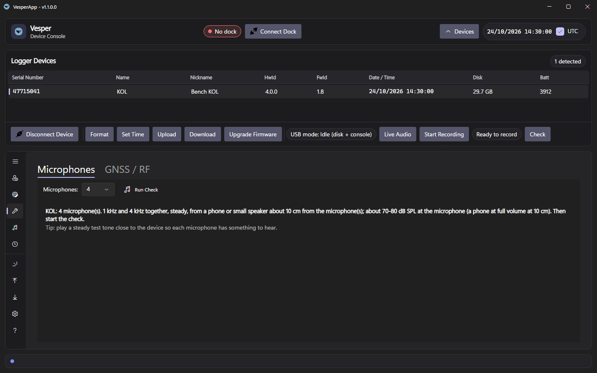

# Device Tests

The **Device Tests** tab bundles per-sensor hardware checks you can run before a deployment. Tests are capability-driven: only the checks a connected product actually supports are offered.

*The Device Tests tab. With a device connected, the microphone health check and (on VT04-VESPER) the GNSS/RF self-test become available.*

## Microphone health check

Verifies that each microphone hears a test tone cleanly, and spots the usual faults: a dead or disconnected microphone, a blocked port, an overloaded or offset input. The same check runs on every product with microphones; the analysis runs on the unit itself.

| Product | Microphones | Firmware |
|---|---|---|
| KOL | 4 (or the 1 / 2 fitted) | 1.8 or later |
| Vesper, Pipistrelle | 1 | the feature release (1.22) or later |

Older firmware is not asked: the page says which firmware the check needs.

**How to run it**

1. Connect the device over USB and select it. It must be idle (not recording, not in Live Audio).
2. For KOL, choose how many microphones are fitted (1, 2 or 4).
3. Play the **test tones** near the device: 1 kHz and 4 kHz together, steady, from a phone or small speaker about 10 cm away (a phone at full volume). Keep a KOL's source centred so all four microphones hear it alike.
4. Press **Run Check**. Each microphone is captured for 150 ms at 48 kHz, one after the other.

**Reading the results**

| Result | Meaning |
|---|---|
| **Healthy** | Both tones clearly above the noise (≥ 12 dB), level and offset normal. |
| **Weak** | The microphone works, but the tones are faint — bring the source closer. |
| **Too quiet** | Hardly any sound at all — check the tones are playing; the port may be blocked. |
| **Too loud** | The input clipped — move the source further away. |
| **No signal** | The microphone's data is stuck (constant): the microphone is faulty, unpowered or disconnected. |
| **Offset** | A large DC offset: the microphone or its supply may be faulty. |
| **Busy** | Live Audio or a recording is running — return to Idle and repeat. |
| **No response** | The device did not answer. |

Each row also shows the measured level (dBFS, and the approximate dB SPL at the microphone). On a KOL the summary warns when the healthy microphones' levels differ by more than 6 dB — usually a blocked port, or a source that is not centred.

The thresholds come from a shared test specification and are first estimates until they are validated on hardware; this is a health check, not a calibrated factory measurement.

## Add-on sensor test

Checks the add-on boards on the connector before a deployment: the unit looks for each board by itself (no configuration needed), reads its device id and takes one live reading.

| Sensor | Boards / parts | KOL | Vesper, Pipistrelle |
|---|---|---|---|
| Motion | IMU10 (LSM6DSM, LSM6DS3 or LSM6DSO), IMU10HT (ICM-20680) | ✓ | ✓ |
| Temperature / humidity | TPRH31 (SHT31) | ✓ | ✓ |
| Light | ALS3001D (OPT3001) | – | ✓ |
| Biopotential | EXG2, EAG2, EXG48 (ADS1292, ADS1192, ADS1298) | – | ✓ |

Firmware: KOL 1.8 or later; Vesper and Pipistrelle 1.22 or later.

**How to run it:** fit the board(s), connect the device over USB and select it (idle — not recording, not in Live Audio), keep it still and press **Run Test**.

| Result | Meaning |
|---|---|
| **Pass** | The board answered with the right id and a sensible reading (shown: the part found and the value — about 1 g at rest for motion, °C and %RH, lux). |
| **Check** | The board answered, but the reading is out of the expected range (e.g. the unit was moving, or a checksum error). |
| **Partial** | The motion board answered but its magnetometer or barometer did not. |
| **Not found** | No board of that type answered — not fitted, badly seated, or another board on the same address (light and temperature boards cannot be stacked together). |
| **No answer** | The unit did not reply — it is recording, or its firmware has no sensor test. |

## GNSS / RF self-test (Vesper)

Exercises the GNSS receive chain in the device's own firmware. This is a **bench test**: it expects a controlled RF environment (a shielded enclosure with an RF generator coupled in), and is primarily used in production and service settings.

The RF generator is driven by the **GNSS RF Test** plugin (an ADALM-Pluto transmitter), installed from the [Plugins](Software-Updates-and-Plugins) page. Without it the panel says so; **Validate Fix** still works on captures you already downloaded (it needs the GNSS Decoder plugin).

- **Check Radio** — looks for the transmitter and shows its station calibration (the per-generator frequency correction).
- **Tone self-test** — the generator transmits a continuous-wave tone and the device must detect it in an RF snapshot. Reported: pass/fail, front-end level, and the tone offset the device measured. Tone offset, generator gain, SNR threshold and snapshot length (64/128/256 ms) are adjustable.
- **Apply Offset** — after a passing tone test on a *reference* unit, adds the measured offset error to the generator's station calibration. Repeat the tone test until the error is small; recalibrate when the generator changes.
- **Positioning test** — pick a scenario (static, or a moving 1 km circle), **Prepare** it once (the plugin generates it locally, a few hundred MB), **Transmit**, capture on the device, download, then **Validate Fix**: every fix is compared against where the scenario puts it; the test passes when the median error is within the tolerance (default 500 m).

If you only need to confirm end-to-end GNSS on real sky, a normal snapshot recording outdoors followed by [GNSS Decoding](GNSS-Decoding) is the simpler route.

**Note: *All the self test features are experimental and may not be available on all devices or firmware versions.**
