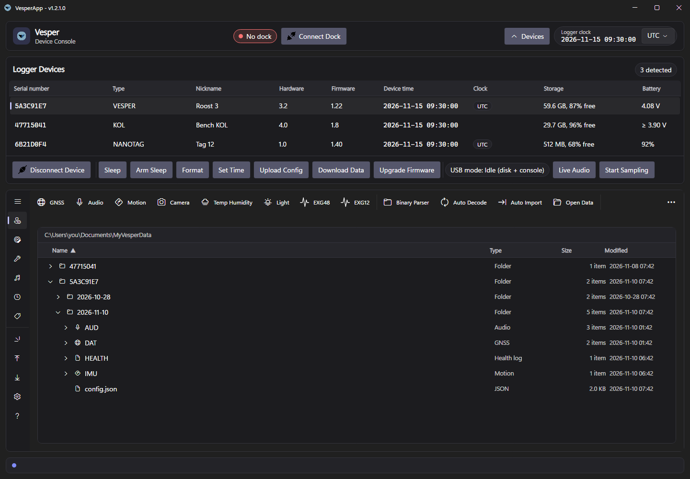

# Recordings

The **Recordings** tab is where device data becomes usable files: it imports raw recordings from a device, parses them into per-sensor streams, and decodes those streams into WAV audio, CSV tables and images.



*The Recordings tab: per-sensor decode actions (GNSS, Audio, Motion, Camera, Temp Humidity, Light, EXG), the one-step Auto Decode / Auto Import workflow, and the data browser on the working directory (one folder per unit, one per recording date, then one per sensor).*

## The pipeline at a glance

```
device storage          working directory
   *.BIN      ──import──►  raw .bin files
                ──parse──►  per-sensor intermediates (.UBN, .MBN, .EBN, …)
               ──decode──►  WAV / CSV / JPG / GNSS fixes
```

1. **Import** copies the raw `*.BIN` recording files from the connected device into your working directory (organised per recording session).
2. **Parse** (phase 1) splits each raw file by sensor type into intermediate files — audio becomes `.UBN`, motion `.MBN`, EXG `.EBN`, environment `.RBN`, light `.LBN`, thermal `.CBN`, and VT04-VESPER GNSS snapshots are extracted into a `DAT` folder.
3. **Decode** (phase 2) turns intermediates into final output: `.UBN` → **WAV**, `.MBN`/`.EBN`/`.RBN`/`.LBN` → **CSV**, `.CBN` → **JPG**, and `DAT` folders are handed to the GNSS decoder plugin ([GNSS Decoding](GNSS-Decoding)).

## Auto Import and Auto Decode

- **Auto Import** opens a guided two-step dialog:
  1. **Select the device drive** — removable drives are detected automatically and identified by the `UID.txt` the firmware writes on the drive (device ID, recording count and date are shown). The most likely drive is pre-selected; a Browse button covers importing from any folder.
  2. **Import to** — the target is pre-filled from your working directory as `<device ID>/<recording date>`, so every session lands in a consistent structure. Edit the path or browse if you want it elsewhere.

  Everything on the drive is imported — including the device's configuration file and `UID.txt` — so each imported session documents which device and configuration produced it. The per-sensor folder structure (`gps`, `aud`, `imu`, …) is preserved, while the device's internal auto-incrementing chunk folders (`0`, `1`, `2`, … holding 256 files each) are flattened away — each sensor's recordings land in a single flat folder.

- **Auto Decode** (Settings → Recordings) chains parsing and decoding onto every import, so a single action takes you from device storage to WAV/CSV output. Progress is shown in the **Decoding Progress** panel (0–50 % parsing, 50–100 % decoding).

Both can be combined with the Settings options *Hide intermediate files* and *Delete raw .bin after successful import* to keep the data browser tidy ([Settings](Settings)).

## Manual operation

You can also drive each stage by hand:

- Point the data browser at any folder containing raw `.bin` files and run **Parse** on it.
- Run **Decode** on a folder of intermediates — useful for re-decoding with different options or after installing the GNSS plugin.
- Use **Manual GPS Parser** on a `DAT` folder to launch a GNSS decode job explicitly.

## Watching progress

Every parse/decode run appears as a job in the non-modal **Decoding Progress** panel:

- live progress bar and elapsed time,
- a scrolling console tail of the decoder's output,
- **Open Log** to inspect the full log file (`logs/gnss/` in the app data folder for GNSS jobs — see [Troubleshooting and FAQ](Troubleshooting-and-FAQ) for per-platform locations),
- **Cancel** while running, **Remove** when finished.

Several jobs can run and be monitored at once; you can keep working in other tabs while they run.

## Audio: usable band, recording check and post-filters

**Usable band.** Next to every decoded WAV the decoder writes `<file>.WAV.txt` with the sample rate, the measured sample rate (see [Exact sample rate and times](#audio-exact-sample-rate-and-times)) and the usable band of that recording: up to 0.44 × the sample rate at the rates recorded with the full anti-aliasing filter, less at the rates that run without it (the note then names the rate to record at instead). The WAV is low-pass filtered at the top of that band. To pick a rate with the full filter, press **Solve** in the [Configuration Editor](Configuration-Editor).

**Recording check** (Vesper and Pipistrelle microphone recordings). Every run is checked when it is decoded, from the sample counts and time stamps the unit writes into its files. The result is one line in the decode summary and the report `AUD\RECORDING-CHECK.TXT` of that session. It reports:

| Finding | Meaning |
|---|---|
| **Sample clock off** | From that point the microphone clock ran at a slightly wrong rate (more than 0.1 % from nominal): the audio after it plays at a slightly wrong speed and pitch. |
| **Crystal clock fell behind** | The unit's clock slowed or stopped for a moment (for example when the board was pressed): time stamps after that point are late by the amount shown. |
| **Audio lost between files** | The gap from the end of one file to the start of the next. A normal file change loses about 19 ms (firmware 1.22); more is reported. |
| **Audio lost inside a file** | The unit could not write for a moment and marked the gap in the file; the report gives the length. |

"No problems found" means none of these occurred. A KOL recording is not checked this way.

**Post-filters** (optional, off by default; **Settings → Recordings → Audio post-filters**, see [Settings](Settings)). With one or both ticked, decoding writes an extra `<name>_EQ.UBN.WAV` next to each microphone WAV, with its own `.WAV.txt` saying what was applied. The original WAV is always kept.

- **Remove the sound-port resonance** — Vesper and Pipistrelle: takes out the peak that the microphone's sound port adds around 26.5 kHz. Not applied to KOL recordings.
- **Notch the 32.768 kHz clock-crystal tone** — removes a slice about 65 Hz wide at the tone, located in each file. When no tone stands out in a file, nothing is removed and the note says so.

## Audio: exact sample rate and times

**In short.** A WAV says it was recorded at the rate you set, for example 100,000 samples per second. The real rate is a little different: each unit's sound clock runs a few hundredths of a percent fast or slow. For listening, spectrograms and call frequencies this does not matter. It matters when you need the **exact time** of a sound late in a long file, or when you **compare several recorders** (for example to locate an animal from the arrival times at each unit). For that, VesperApp measures the real rate of every audio file and writes it next to the file.

**Why the rate is off.** The unit keeps its time with a small quartz crystal and corrects that time with its clock calibration. The microphone clock is built from the same crystal, but it does not get that correction: it runs about 0.011 % (107 parts per million, ppm) fast by design, plus the crystal's own error, typically within ±0.03 %. While recording, the unit writes a time stamp into the file about every 32,760 samples (every third of a second at 100 kHz). From those stamps VesperApp measures how many samples the unit really recorded per second. This works for Vesper, Pipistrelle and KOL recordings, and for files from older firmware too.

**Where to find it.** Open the session folder in the system file explorer (right-click → **Open in system file explorer**; the browser hides `.txt` files). Next to each WAV:

- `<file>.WAV.txt` holds the summary:

  ```
  SampleRate: 100000
  MeasuredRate: 100010.67
  ClockPpm: +106.7
  ClockFit: 1831 SYNC stamps over 599.8 s, largest deviation 0.6 ms
  ```

- `<file>.UBN.txt` holds the same three lines and every time stamp as a `Sync:` line, for example `Sync:20/11/2026 21:14:59.821:89991720`: the date and time (day/month/year, to the millisecond), then the sample number in the WAV at that moment (the first sample of the WAV is sample 0). The time has no trailing zeros: `.84` means `.840`.

| Line | Meaning |
|---|---|
| `SampleRate` | The rate you set: the rate in the WAV header. Audio programs use it. |
| `MeasuredRate` | Samples per real second, measured over this file (2 decimals). |
| `ClockPpm` | The same as a difference from `SampleRate`, in ppm (millionths). +106.7 ppm means 106.7 samples more per million than the WAV says. |
| `ClockFit` | How many time stamps were used, over how long, and how far the furthest one sits from a straight line. A few ms is normal (the stamps are 1 ms steps). "uneven" means the clock changed inside the file (see below). |

A file shorter than 10 seconds gets no `MeasuredRate`: too few stamps for a better answer. Use `SampleRate`; over 10 seconds the error stays under 4 ms.

**Example 1: the time of a sound.** A file starts at 21:00:00.000 (the start time is in the file name). `SampleRate` is 100000 and `MeasuredRate` is 100010.67. A bat call starts at sample 90,000,000.

- With the WAV rate: 90,000,000 ÷ 100,000 = 900.000 s → 21:15:00.000.
- With the measured rate: 90,000,000 ÷ 100,010.67 = 899.904 s → **21:14:59.904**.

The WAV rate puts the call 96 ms too late. The difference grows with the time into the file: about 0.4 s per hour for this unit.

**Example 2: a time read in an audio program.** Audacity, Kaleidoscope, Raven and similar programs show times from the WAV rate. Convert them with:

> real time into the file = time shown × SampleRate ÷ MeasuredRate

The program shows the call at 00:15:00.000 = 900 s. 900 × 100,000 ÷ 100,010.67 = **899.904 s**, the same as in example 1.

**Example 3: the most exact time, from the `Sync` lines.** The measured rate is an average over the file. Temperature changes the rate slightly during a long file; the `Sync` lines follow it. Take the two `Sync` lines around your sample and share the time between them in proportion:

```
Sync:20/11/2026 21:14:59.821:89991720
Sync:20/11/2026 21:15:00.149:90024480
```

The call at sample 90,000,000 is 8,280 samples after the first line; the two lines are 32,760 samples and 0.328 s apart. 8,280 ÷ 32,760 × 0.328 s = 0.083 s, so the call is at 21:14:59.821 + 0.083 s = **21:14:59.904**. In a spreadsheet: put the sample numbers and times of the `Sync` lines in two columns, and for any sample use `FORECAST.LINEAR` on the two rows around it.

**Example 4: comparing two recorders.** Unit A shows `ClockPpm: +106.7`, unit B `ClockPpm: -97.3`. Both record the same sound one hour after their files started. Counted with the WAV rate, unit A gives 3,600.384 s and unit B 3,599.650 s: the two units disagree by 0.73 s, the time sound needs to travel about 250 m. With each unit's own `MeasuredRate` (or its `Sync` lines), both give 3,600.000 s, and what is left is the time stamps' own precision, about a millisecond. (The units' clocks must of course be set and calibrated: see [Clock calibration](Clock-Calibration).)

**Example 5: frequencies.** A WAV played at the rate in its header shows every frequency short by the same fraction. A 40,000 Hz call recorded by unit A shows at 40,000 × 100,000 ÷ 100,010.67 = 39,995.7 Hz: 4 Hz off, far below what matters for identifying calls. No correction is needed.

**If you need a WAV at the true rate.** Most analysis programs let you enter the sample rate of a file: enter `MeasuredRate`. Some programs accept only whole numbers; round it (100,011 Hz). Rounding leaves at most half a sample per second: 5 ppm at 100 kHz, about 18 ms per hour.

**When something looks wrong.**

- `ClockPpm` beyond ±1,000 (0.1 %): the microphone clock lost its lock to the crystal. For Vesper and Pipistrelle recordings the [recording check](#audio-usable-band-recording-check-and-post-filters) reports it as "Sample clock off". The measured rate is still right for that file as a whole, but if the clock changed in the middle, use the `Sync` lines.
- `ClockFit` says "uneven": the clock changed inside the file (it lost its lock part-way, or the crystal stalled for a moment). Use the `Sync` lines (example 3) and, for Vesper and Pipistrelle, see `AUD\RECORDING-CHECK.TXT`.

## Where files go

Everything lands in your **working directory** (default `Documents/MyVesperData`, configurable in [Settings](Settings)), preserving a per-session folder structure with per-sensor subfolders (`AUD`, `IMU`, `EXG`, `TPRH`, `ALS`, `THCAM`, `PRX`, `LOG`, `DAQ`, `HEALTH`, `DAT`).

## The live data browser

The Recordings tab's browser is a **live view of the working directory**: it opens there on every start (the full path is shown in the bar above the tree) and follows changes on disk automatically — imports, decodes, or files added by other programs appear within a second, with the tree's expansion state preserved. No manual refresh is needed or offered.

The tree has four columns — **Name**, **Type**, **Size** and **Modified**. Click a column header to sort by it (click again to reverse); folders always sort before files, at every level. The Type column identifies raw recordings by their sensor (GPS, Audio, Motion, …), parsed intermediates, and decoded outputs. Known sensor folders are labelled (Audio, Motion, GNSS, …); metadata sidecars are hidden, and intermediates can be hidden too ([Settings](Settings)).

Double-click behaviour:

- **Folder** — expand / collapse.
- **Configuration `.json`** — if the file is recognised as a device configuration, the app offers to open it in the [Configuration editor](Configuration-Editor) (with a confirmation, since unsaved editor changes would be lost). Other `.json` files open normally.
- **Any other file** — open with the OS default application.

Right-click a selection (multi-select works) for actions:

| Action | Effect |
|---|---|
| **Decode** | Raw `.bin` → parse + decode; intermediates / `DAT` folders → decode. Folders decode everything under them. |
| **Parse only** | Strip/split raw `.bin` into intermediates without decoding |
| **Open** | Open the file/folder with the OS default app |
| **Open in system file explorer** | Open the folder (or the file's folder) in the OS file manager — Explorer, Finder or the Linux default |
| **Delete…** | Delete the selection from disk (with confirmation) |

Right-clicking selects the row under the cursor, so the menu always acts on what you clicked. Selection actions and the toolbar's file-picker buttons feed the same decoders — use whichever fits the moment.

## Raw file format reference

Internal details of the on-device `.bin` files — useful when debugging a parse or handling recordings outside the app.

### File naming

Devices write raw files as `XXXC.bin`, where `XXX` is a sequential number and `C` a single letter identifying the sensor:

| Letter | Sensor |
|---|---|
| `G` | GPS |
| `U`, `U0`–`U3` | Audio (`U0`–`U3` on multichannel recorders like KOL) |
| `M` | IMU modules |
| `E` | Biopotential (EEG / ECG / EMG) |
| `R` | Temperature & humidity |
| `L` | Ambient light |
| `X` | Proximity |
| `O` | Log |
| `S` | Analog DAQ |
| `C` | Cameras |
| `H` | Health logger (LOGGER) |

### Standard binary layout

All sensor files except camera, GPS and proximity share one structure — a 128-byte file header followed by one or more data blocks (there may be time gaps between blocks):

```
| 128-byte file header | [ 16-byte block header | data | 16-byte optional sync | data | 16-byte block footer ] …
```

The file header is identified by the signature `0xDEAFDAC0`; all fields are **little endian**. It carries:

| Field | Size |
|---|---|
| Device unique identifier | 32-bit |
| Device name | 16 × 8-bit ASCII |
| Firmware version | 16-bit |
| Hardware version | 16-bit |
| Sampling rate | 32-bit |
| Window rate | 32-bit |
| Window length | 32-bit |
| Bitmask | 32-bit |
| Configuration data 0–3 | 4 × 32-bit |

### Health logger files (`H`)

The optional **LOGGER** sensor (KOL firmware 1.8, Vesper and Pipistrelle firmware with the logger) writes `/log/<n>H.BIN` in the standard layout: the file header names the sensor `LOGGER`; *Sampling rate* is the sample period in ms, *Configuration data 0* the field mask, *Configuration data 1* the format version and device type. The data is a series of 4-byte-aligned records, each starting with an 8-byte header — type, size, info and the time in seconds since 1 January 2000:

| Type | Info | Payload |
|---|---|---|
| `0x01` sample | fields present (bit 0 battery, 1 temperature, 2 clock correction, 3 sensors) | one 32-bit value per field: battery mV (Vesper / Pipistrelle / Nanotag: the cell; KOL: the battery-sense pin, half the battery after its diode; −1 = no reading, −2 = above range), temperature in 0.01 °C, correction in ppb, bitmap of sampling sensors |
| `0x11` / `0x12` / `0x13` event | event code | none (error / warning / debug) |

**Auto Decode** writes `<file>.csv` (one row per sample) and `<file>.log.csv` (time, level, code and a readable name per event) into the `HEALTH` folder. Every code is explained in [Log Codes](Log-Codes).

On a **Nanotag** (firmware 1.35 or later) the logger has no file: its records live in a ring of NAND pages. **Download Data** reads them after the data pages and writes the same `HEALTH/H<first>-H<last>.HBN` with its `.csv` and `.log.csv` into the download folder. The same download also writes the Nanotag add-on boards (firmware 1.36 or later) as Vesper does: `TPRH/R….RBN` (temperature / humidity), `ALS/L….LBN` (light) and `PRX/X….XBN` (ProxTit encounters), one file per sensor session, each decoded to `<file>.csv`.

### ProxTit encounter files (`X`)

`X.BIN` (Vesper) and the Nanotag `PRX` pages hold 16-byte encounter records, exactly as the ProxTit tag delivers them: start time (Unix seconds on the tag clock), duration in seconds, the peer's 6-byte BLE address, the averaged RSSI and the peer's TX power in dBm. **Auto Decode** writes `<file>.csv` with start, end, duration, address, RSSI and TX power per encounter.


### GPS snapshot files

GPS `.bin` files differ: a 1024-byte metadata header followed by raw I/Q sample data. The metadata starts with a 16-byte header carrying the magic word `0xA55AA55A`:

```
| 32-bit magic word | 32-bit time | 32-bit date | 16-bit subsecond fraction | 16-bit subsecond |
```

- **Time** packs hours, minutes, seconds and a reserved byte (8-bit each).
- **Date** packs a reserved byte, month, day and year (8-bit each).

During parsing each snapshot is written out as `snap.YYYY_MM_dd_hh_mm_ss_GC0.dat` using the extracted timestamp, in UTC when the recording's `CLOCK.TXT` gives the unit's time base (otherwise in the unit's own time) — these are the `DAT` folders handed to the GNSS decoder plugin ([GNSS Decoding](GNSS-Decoding)).
