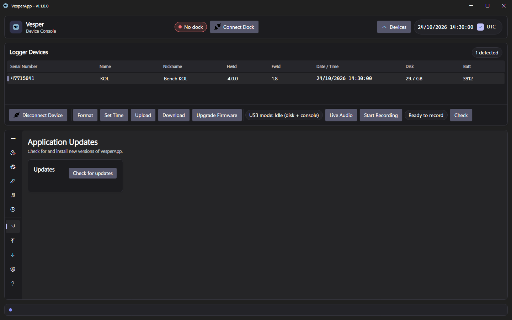
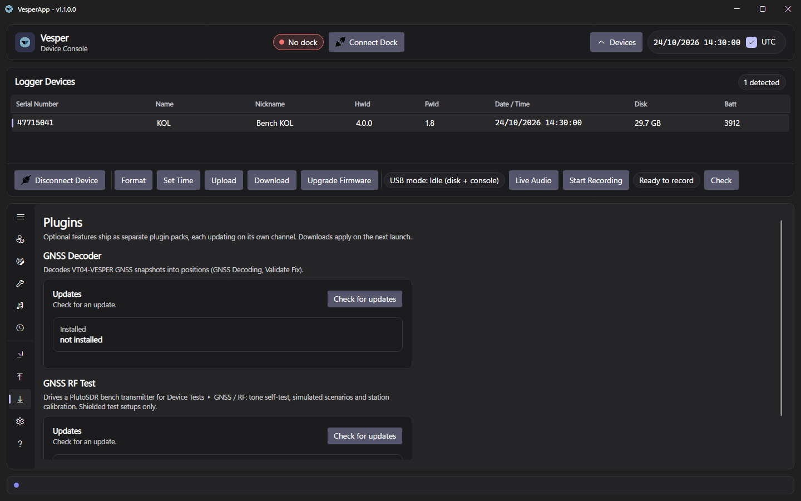

# Software Updates and Plugins

VesperApp keeps three things current, each on its own independent channel: the **application** itself, **device firmware** (covered in [Firmware Updates](Firmware-Updates)) and **plugins**.

## Updating the app

The **Software Upgrades** tab manages the application's own updates:

*The Software Upgrades tab.*

1. Press **Check for updates**. The app polls the release channel it was installed from (shown on the page as *Update channel*), for your platform — stable, or beta for a beta install. Only a newer version is ever offered.
2. If a newer version exists, its version number is shown next to your installed version. Press **Download** — updates are delta-patched where possible, so downloads are small (a full download is used automatically when no delta path exists).
3. When the download finishes, press **Restart & Apply**. The app relaunches on the new version.

Updates are published per platform (Windows x64, Windows x86, Linux x64). Beta-channel builds exist for early testing and are installed manually from a beta setup; a beta install then updates to newer betas. To go back, press **Leave beta (switch to stable)** (shown only on a beta install): it checks the stable channel and offers the stable release even when its version number is lower than your beta.

On **Linux**, applying an update replaces the AppImage file in place, so the AppImage must live in a user-writable location — see [Linux Setup](Linux-Setup).

## Plugins

Some functionality ships as optional plugins that install into your per-user plugin folder and update independently of the app:

- **GNSS Decoder** — enables [GNSS Decoding](GNSS-Decoding) of VT04-VESPER snapshots.
- **GNSS RF Test** — drives a bench RF generator for the GNSS tests in [Device Tests](Device-Tests) (shielded test setups only).

*The Plugins tab.*

On the **Plugins** tab each plugin has its own card:

1. The card shows the plugin's installed version, or *not installed*.
2. Press **Check for updates** to poll the plugin feed.
3. If a new version is available, download it. Plugins are applied **on the next launch** — the page will indicate a pending restart.

A version that is published but cannot be loaded by your VesperApp (for example a pack built without a plugin adapter, or for a different compatibility version) is not offered; the card says which version it is and why. If an installed pack cannot be loaded, the card says so and offers the published version as a repair.

Notes:

- Without a plugin, everything else works normally; the feature that needs it reports that the plugin is not installed.
- Plugin packs are validated before loading (platform, compatibility version, integrity), so an incompatible pack is rejected cleanly rather than breaking the app.
- App updates never remove installed plugins — the two update paths are deliberately separate.

## Security model

All feeds and downloads go over HTTPS from the official distribution CDN, assets are SHA-256-verified after download, and the application contains **no embedded credentials**. Development builds without a configured feed simply report that update checking is unavailable.
