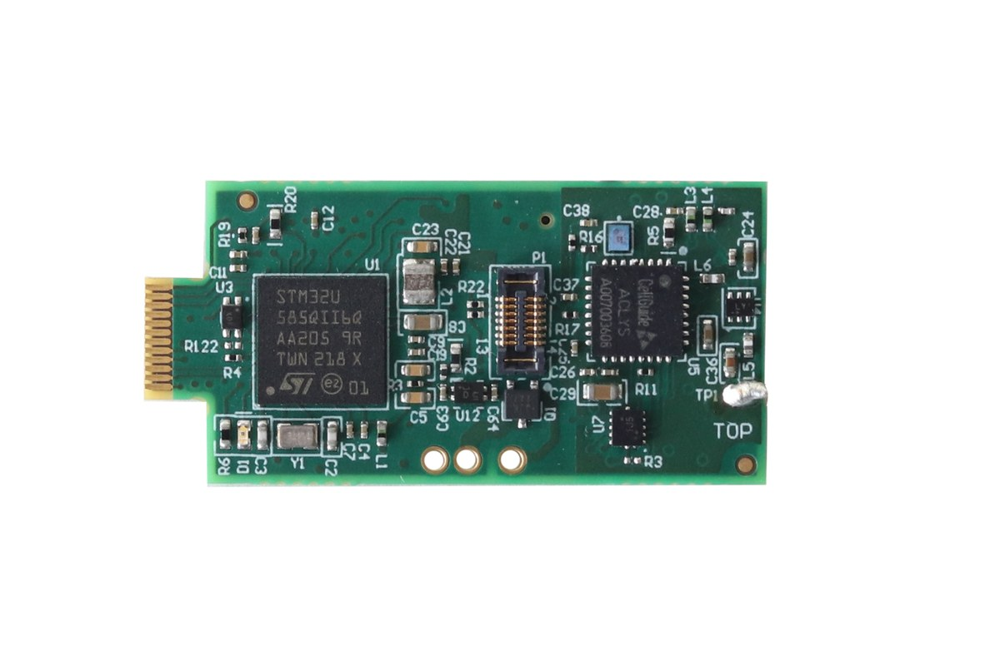
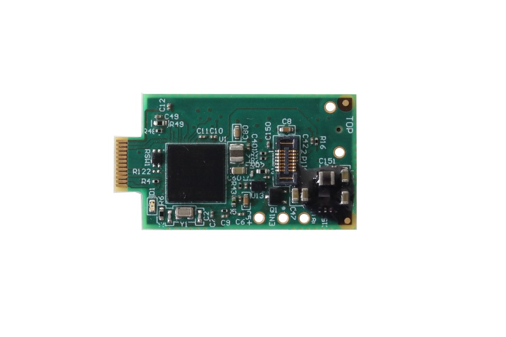
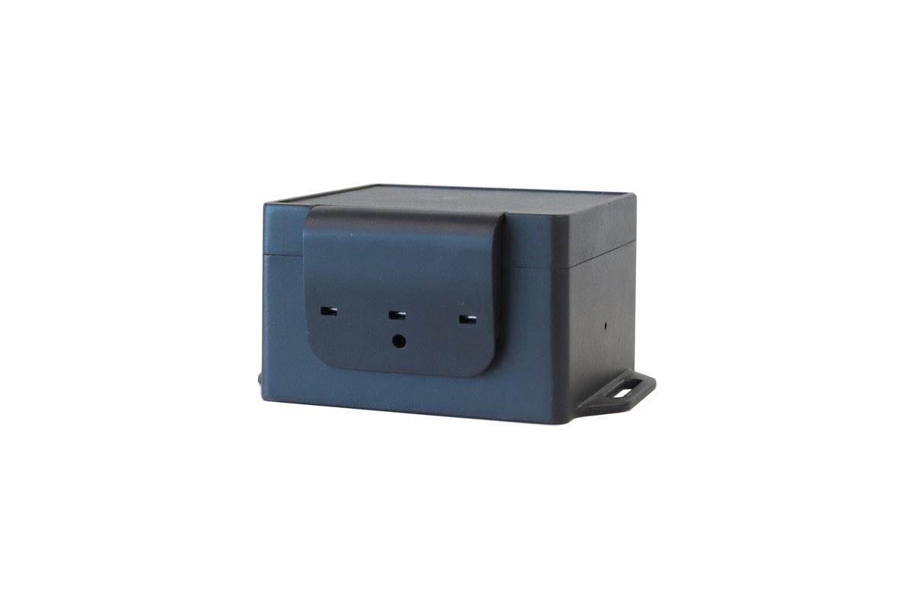
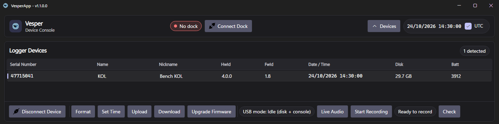
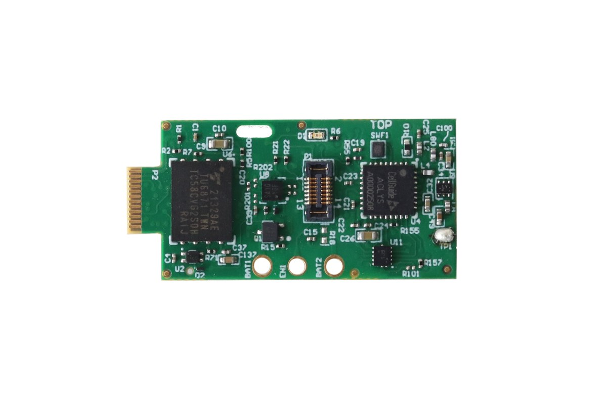

# Supported Devices

VesperApp works with the ASD logger and tag product family:

| Product | Shown in app as | Microphones | GNSS | Connection |
|---|---|---|---|---|
| **Vesper** | VT04-VESPER | 1 | Yes (snapshot GNSS) | Docking station (direct USB from firmware 1.22) |
| **Pipistrelle** | VT04-PP | 1 | No | Docking station (direct USB from firmware 1.22) |
| **KOL** | KOL | up to 4 (1/2/4-mic configurations) | No | Direct USB (dock optional) |
| **Nanotag** | Nanotag | none | Yes (snapshot GNSS) | Docking station |

The VT04-family loggers are card-edge boards: the gold edge connector slides into the docking station's LOGGER slot (match the **TOP** silkscreen marking with the slot's TOP side).

## Upload Config and Download Data

The two toolbar buttons work with every device:

| Button | Nanotag | Vesper, Pipistrelle, KOL |
|---|---|---|
| **Upload Config** | Sends the chosen configuration file to the tag over USB | Copies the chosen file to the unit's USB disk as `config.json` (a KOL is told to read it again) |
| **Download Data** | Downloads every page of the tag (data, add-on pages, the LOGGER log) into a folder you choose | Opens the import on the [Recordings](Recordings) page with the unit's disk already selected, and copies the recorded files |

The unit's disk is found by the `UID.TXT` the firmware writes on it. Both buttons need the disk: they are disabled while a KOL is in Live Audio.

## VT04-VESPER

*The VT04-VESPER board (shown without antenna): STM32U585 MCU and Aclys snapshot-GNSS receiver, with the dock card-edge connector on the left.*

The flagship logger. Records audio plus a full set of environmental sensors, and captures **GNSS snapshots** — short raw RF captures that are post-processed on the computer into position fixes (see [GNSS Decoding](GNSS-Decoding)). Because the heavy GNSS math happens offline, the tag itself spends almost no energy on positioning.

- Single MEMS microphone.
- Snapshot GNSS receiver with an in-firmware RF self-test (see [Device Tests](Device-Tests)).
- Sensor suite (depending on configuration): inertial/motion (IMU), EXG biopotential, temperature/pressure/humidity, ambient light, thermal camera, proximity.

## VT04-PP (Pipistrelle)

*The VT04-PP board — the same VT04 platform without the GNSS receiver.*

An audio-focused logger sharing the VT04 platform, with a single MEMS microphone and the same scheduling and sensor-driver system, without the GNSS receiver.

## KOL

*The KOL acoustic logger in its field enclosure.*

A multi-microphone logger with a **4-microphone array** that can be configured to record 1, 2 or 4 channels. Recordings are stored per-channel and decode to multi-file WAV output. The [mic health check](Device-Tests) tests each microphone in the array individually.

### KOL operating states (KOL firmware 1.8 or later)

The KOL is not activated with a magnet. Its USB cable decides what it does:

*A KOL in the device console: its USB mode, **Live Audio**, **Start Recording**, whether it is ready to record (hover for card, config.json and clock) and **Check**.*

| State | When | LED | What the computer sees |
|---|---|---|---|
| **Sleep** | Unplugged and not recording | Off (one 2 s flash when it goes to sleep) | Nothing |
| **Idle** | Connected to a computer | **1 Hz**: ready to record · **2 Hz**: `config.json` missing or not valid · **5 Hz**: no usable SD card | Console + USB disk |
| **Live Audio** | Chosen in the app, from Idle | On | Console + a 4-channel USB microphone (see below) |
| **Recording** | **Start Recording** in the app | 3 blinks, then off | Nothing — the KOL leaves USB and records according to `config.json` |

- **Plug it into a computer** and it wakes into Idle; **unplug it** and it sleeps. A charger or power bank (no computer answers within 5 s) also puts it to sleep.
- **Start Recording** works only when an SD card is inserted and readable, `config.json` is valid with at least one sensor enabled, the clock has been set and there is room for at least one recording file. The device console shows whether the unit is ready (hover for the details); **Check** has the KOL read `config.json` again after you copy a new one onto its USB disk. If the clock is the only thing missing, Start Recording offers to set it.
- **Recording continues on battery.** To stop it, unplug the KOL and connect it to a computer: it returns to Idle within about 5 s. A charger or power bank does not stop a recording. A recording started with the cable attached ignores that cable until it is unplugged. A dated schedule that has run to its end puts the KOL to sleep.
- **A KOL stops recording by itself** (firmware 1.8 or later) when its battery runs low or its SD card is full. A new set of files is started only when the card has room for it, so the files of a full card all end normally. The unit closes its files, records the reason in its LOGGER ("Battery low: recording stopped" or "Storage full" in the `.log.csv`, see [Recordings](Recordings)) and sleeps; it does not resume after a restart.
- **No SD card** at start-up: the KOL still connects (Idle, 5 Hz) and says so; insert a card and it restarts and mounts it by itself.
- **Sleep** and **Arm Sleep** are not shown for a KOL — it sleeps by itself when unplugged and records through Start Recording. The small button next to the SD card (SW3) is only for firmware recovery.
- The tooltip's *Sleeps when unplugged* line reads "not yet" until the KOL has seen its USB power come and go once; boards without the VBUS-sense resistor change never sleep and stay in Idle on battery.

### USB modes (KOL; Vesper and Pipistrelle with firmware 1.22 or later)

A connected KOL has three **USB modes**, shown and switched from the device console when the unit is selected. A Vesper or Pipistrelle running firmware 1.22 or later has the same three modes:

| Mode | What the computer sees | Use it for |
|---|---|---|
| **Idle** | Console + USB disk | Configuration, downloading recordings, firmware updates. The default when the device is not armed. |
| **Live Audio** | Console + a standard USB microphone: **4 channels on a KOL** (16-bit; 8, 16, 32, 48 or 96 kHz selectable in the OS), **1 channel on a Vesper or Pipistrelle** (16-bit; 8, 16, 32, 48, 96 or 192 kHz; appears as "Vesper Wildlife Logger") | Listening to or recording the microphones live with any audio application, and the app's own [Live View](Live-View) tab (scope, spectrum, spectrogram, live microphone parameters). No disk is exposed in this mode. |
| **Sampling** | Nothing — the device leaves USB | Running the recording schedule. On a Vesper or Pipistrelle (and a KOL with firmware older than 1.8), **Start Sampling** arms the device and it disconnects; reconnect it later (or use the magnet) to return to Idle; with firmware 1.22 or later it also stops by itself when its battery runs low or its storage is full (files closed, reason in the LOGGER, then it sleeps). On a KOL with firmware 1.8 or later this is **Start Recording** (above). |

Switching between Idle and Live Audio makes the device briefly disappear and re-appear on USB; the app reconnects it automatically. On Windows the first switch may take a few extra seconds while the microphone driver is installed.

The microphone parameters (gain, high-pass, decimation filters) can be changed live from [Live View](Live-View); they are the same fields as in the device's `config.json`.

Firmware updates need no dock on the KOL, nor on a Vesper or Pipistrelle that already runs firmware 1.22 or later — see [Firmware Updates](Firmware-Updates).

## Nanotag

*The Nanotag board (shown without antenna), with its Aclys snapshot-GNSS receiver.*

A miniature tracking tag with a snapshot-GNSS receiver. It connects through the docking station, like Vesper and Pipistrelle. It has no microphone; its data and firmware path differ from the VT04 family: it has no USB disk (configuration and data go over USB commands), and firmware updates use a USB-HID bootloader rather than the dock-driven DFU flow (see [Firmware Updates](Firmware-Updates)).

The **Nanotag** page (left menu) has three parts:

- **Disk health** (firmware 1.39 or later): good, bad and to-be-retired blocks, pages written and free space, and the pages read since the tag started that needed ECC correction or could not be read. It also shows a format in progress, and a **block map**: one cell per 256 KB block (64 a row, block 0 top left) coloured as data, free, bad, to retire at the next format, bad-block table or LOGGER log, with the numbers of the bad blocks. After a download, the pages that did not read cleanly, or whose data CRC does not match, are listed in `download-read-status.txt` in the download folder.
- **Configuration on the tag**: **Read** shows what the tag holds (general settings, driver slots, schedule), to check an upload. **Save…** keeps it as a JSON report; that report is not a file to upload again.
- **Console**: the tag's text console (the `help`, `ver`, `disk`, `config` … commands). The tag's serial port is listed first; **Open** connects. Up and Down recall earlier commands. The console can stay open while VesperApp talks to the tag.

**Format** on a Nanotag (firmware 1.39 or later) answers at once and erases in the background: about 1 s on an empty tag, longer with more data; the LED blinks fast until it is done. The status line follows the progress and then reports the bad blocks, and whether the format added any (it should not, unless a block failed). The Nanotag page shows the block map after it.

## Sensor data types

Devices store each sensor stream as a separate raw file on internal storage. During [import and parsing](Recordings) these are recognised by name:

| Raw file | Sensor | Decoded output |
|---|---|---|
| `U.BIN` / `U0.BIN`–`U3.BIN` | Audio (1–4 channels) | WAV |
| `M.BIN` | Inertial / motion (IMU) | CSV |
| `E.BIN` | EXG biopotential (EXG48 or EXG1292, per device metadata) | CSV |
| `R.BIN` | Temperature / pressure / humidity | CSV |
| `L.BIN` | Ambient light | CSV |
| `C.BIN` | Thermal camera (Lepton) | JPG images |
| `G.BIN` | GNSS snapshots (VT04-VESPER) | Position fixes via the GNSS plugin |
| `H.BIN` | Health logger (LOGGER): battery, MCU temperature, clock correction, sampling sensors, event codes | Two CSVs: samples and events |
| `X.BIN`, `O.BIN`, `S.BIN` | Proximity / log / auxiliary streams | Parsed and kept for analysis tools |
